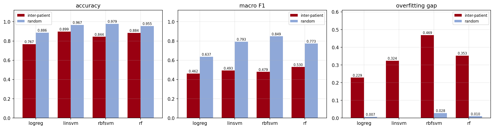
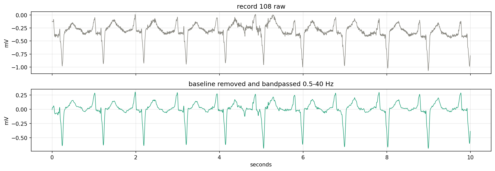
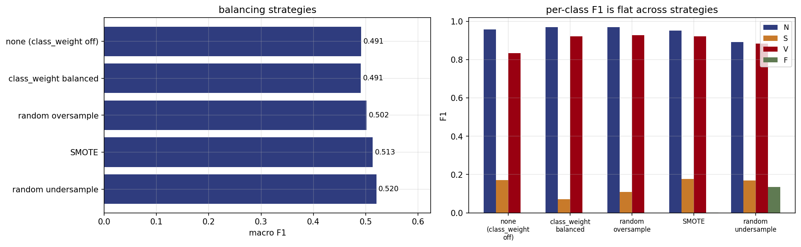
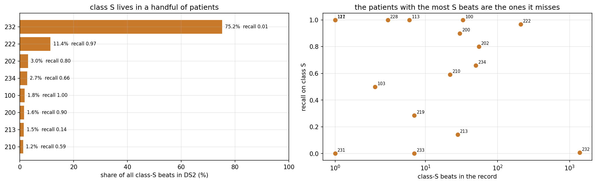
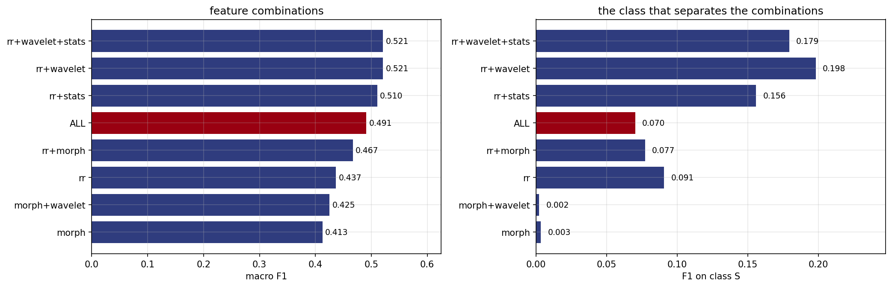
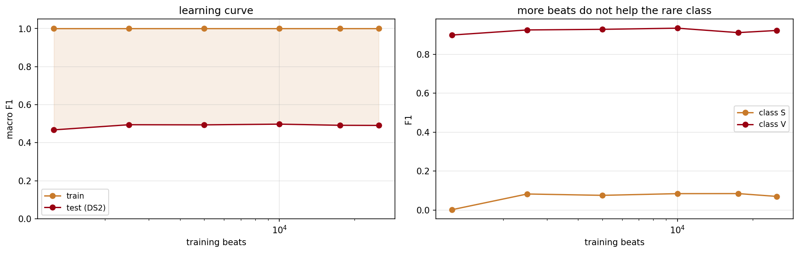
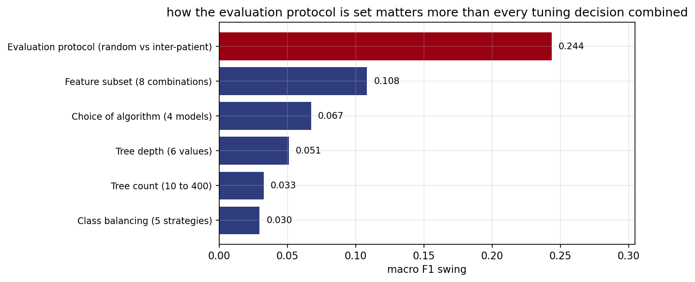

# ECG Arrhythmia Classification with Classical Machine Learning

Beat-level classification of ECG heartbeats into four AAMI classes (N / S / V / F) on the
MIT-BIH Arrhythmia Database. Classical machine learning only: no neural networks anywhere in
the pipeline.

The point of the project is not the headline score. It is that **the same model and the same
data produce 95.5% accuracy or 88.4% accuracy depending on one
decision about how the data is split**, and that the published literature is full of the first
number.

## Headline result

| | Random beat split | Inter-patient split (DS1 -> DS2) |
|---|---|---|
| Accuracy | 0.9548 | 0.8837 |
| Macro F1 | 0.7735 | 0.5298 |
| Weighted F1 | 0.9605 | 0.8980 |
| Cohen's kappa | 0.7999 | 0.5197 |
| F1 on class S | 0.865 | 0.185 |
| F1 on class F | 0.576 | 0.112 |

The random split lets the same patient appear on both sides. The model then recognises the
patient rather than the arrhythmia. Separating the patients changes accuracy by
-7.1 points and macro F1 by
-24.4 points.



## Data

| | |
|---|---|
| Source | MIT-BIH Arrhythmia Database, PhysioNet, open access |
| Recordings | 44 of 48, half-hour two-lead Holter, 360 Hz |
| Excluded | 102, 104, 107, 217 (paced rhythms, per AAMI EC57) |
| Beats | 100,679 annotated and usable |
| Classes | N (Normal), S (Supraventricular), V (Ventricular), F (Fusion) |
| Imbalance | 112:1 between N and F |
| Protocol | de Chazal DS1/DS2, 22 patients train, 22 test, zero overlap |

| class | meaning | beats | share_pct | ratio_to_N |
|---|---|---|---|---|
| N | Normal | 90125 | 89.48 | 1 |
| S | Supraventricular | 2781 | 2.76 | 32 |
| V | Ventricular | 7009 | 6.96 | 13 |
| F | Fusion | 803 | 0.8 | 112 |

## Pipeline

1. **Collection** - `wfdb` streams records straight from PhysioNet, cached as `.npy`
2. **Cleaning** - median-filter baseline removal (200 ms then 600 ms), zero-phase Butterworth 0.5-40 Hz
3. **Segmentation** - 250 ms before the annotated R peak to 450 ms after, 252 samples per beat
4. **Feature engineering** - 61 handcrafted features in four families
5. **Selection** - 2 features removed at correlation > 0.97, 59 kept
6. **Models** - logistic regression, linear SVM, RBF SVM, random forest
7. **Tuning** - grid search with `StratifiedGroupKFold` grouped by patient, so no patient crosses an inner fold
8. **Evaluation** - both protocols, per-class metrics, confusion matrices, ablations, learning and validation curves

| family | kept |
|---|---|
| rr | 8 |
| morph | 32 |
| wavelet | 13 |
| stats | 6 |
| TOTAL kept | 59 |
| dropped (corr > 0.97) | 2 |



## What the experiments show

| n | finding | evidence |
|---|---|---|
| 1 | Best model under the honest protocol | rf: accuracy 0.8837, macro F1 0.5298, kappa 0.5197 |
| 2 | Accuracy hides the failure; macro F1 does not | accuracy falls +7.1 pts between protocols, macro F1 falls +24.4 pts |
| 3 | Weighted F1 is accuracy wearing a different name | weighted F1 0.8980 vs accuracy 0.8837, difference 0.0143 |
| 4 | Sharing patients between train and test inflates the rare classes | F1(S) 0.865 -> 0.185, F1(F) 0.576 -> 0.112 |
| 5 | Class imbalance is not the bottleneck | five balancing strategies move F1(S) by only 0.1071 |
| 6 | Only the timing features detect class S | RR alone F1(S) 0.0906, best of the other three families 0.0084 |
| 7 | Adding every feature is worse than choosing a subset | rr+wavelet+stats macro F1 0.5209 vs ALL 0.4908 |
| 8 | More beats do not help; more patients would | 20x more training beats buys +0.0233 macro F1 |
| 9 | Depth causes the overfitting, not tree count | gap 0.249 at depth 4 vs 0.509 unlimited; 0.508 to 0.536 across 10-400 trees |
| 10 | The result is one patient away from looking different | excluding record 232 changes F1(S) by +0.1712 |
| 11 | Choosing hyperparameters on the test set adds optimism | +0.0045 macro F1 from letting DS2 pick the depth |
| 12 | Fold-to-fold variation is larger than any tuning gain | grouped 5-fold macro F1 0.4882 +/- 0.0629 |
| 13 | The pipeline has no leakage of its own | shuffled labels score 0.2355 against the always-N baseline 0.2355 |
| 14 | Dropping class F does not rescue the task | 3-class macro F1 0.6511 vs 4-class 0.5298 |

### Imbalance is not the explanation

The obvious diagnosis for 0.185 F1 on a 2.8% class is imbalance. Five
balancing strategies say otherwise: F1 on class S moves by only
0.1071 across all of them.

| strategy | train_rows | f1_macro | f1_S | f1_V | f1_F |
|---|---|---|---|---|---|
| none (class_weight off) | 25000 | 0.4915 | 0.1715 | 0.8352 | 0.0 |
| class_weight balanced | 25000 | 0.4908 | 0.0702 | 0.9221 | 0.0 |
| random oversample | 89908 | 0.5019 | 0.1087 | 0.9284 | 0.0 |
| SMOTE | 89908 | 0.5134 | 0.1773 | 0.922 | 0.0013 |
| random undersample | 812 | 0.5204 | 0.1687 | 0.885 | 0.1344 |

SMOTE interpolates between existing minority beats, and those beats come from a handful of
patients. Synthetic beats inherit that handful. The training set gets larger, not more varied.



### The failure is a patient problem

| record | S_beats | share_of_DS2_S_pct | recall_S |
|---|---|---|---|
| 232 | 1382 | 75.2 | 0.008 |
| 222 | 209 | 11.4 | 0.9665 |
| 202 | 55 | 3.0 | 0.8 |
| 234 | 50 | 2.7 | 0.66 |
| 100 | 33 | 1.8 | 1.0 |

Record 232 alone holds 75.2% of all class-S beats
in the test set, at recall 0.008. Remove that one patient and
F1 on class S moves +0.1712. A result that one patient can swing that far
is a result about patients, not about arrhythmias.



### Only timing features see class S

| family | n_features | f1_macro | f1_N | f1_S | f1_V | f1_F |
|---|---|---|---|---|---|---|
| rr | 8 | 0.4369 | 0.9545 | 0.0906 | 0.6981 | 0.0044 |
| morph | 32 | 0.4126 | 0.9604 | 0.0033 | 0.6869 | 0.0 |
| wavelet | 13 | 0.367 | 0.951 | 0.0084 | 0.5044 | 0.0042 |
| stats | 6 | 0.3826 | 0.9531 | 0.001 | 0.5761 | 0.0 |
| ALL | 59 | 0.4908 | 0.971 | 0.0702 | 0.9221 | 0.0 |

Supraventricular beats are defined by *when* they arrive, not by what they look like. The beat
shape is close to normal, which is why the morphology and wavelet families score
0.0084 and below on class S while RR intervals alone reach 0.0906.

On class S, RR alone scores 0.0906 and every feature together scores
0.0702, so adding the other families leaves class S worse:

| combination | n_features | f1_macro | f1_S |
|---|---|---|---|
| rr+wavelet+stats | 27 | 0.5209 | 0.1794 |
| rr+wavelet | 21 | 0.5207 | 0.1982 |
| rr+stats | 14 | 0.5105 | 0.1559 |
| ALL | 59 | 0.4908 | 0.0702 |
| rr+morph | 40 | 0.4668 | 0.0772 |
| rr | 8 | 0.4369 | 0.0906 |
| morph+wavelet | 45 | 0.4252 | 0.0022 |
| morph | 32 | 0.4126 | 0.0033 |



### The data ceiling is patients, not beats

| train_beats | train_patients | train_f1 | test_f1 | gap | f1_S |
|---|---|---|---|---|---|
| 1250 | 22 | 1.0 | 0.4675 | 0.5325 | 0.0022 |
| 2500 | 22 | 1.0 | 0.4945 | 0.5055 | 0.0827 |
| 5000 | 22 | 1.0 | 0.4938 | 0.5062 | 0.0758 |
| 10000 | 22 | 1.0 | 0.4976 | 0.5024 | 0.0845 |
| 17500 | 22 | 1.0 | 0.4915 | 0.5085 | 0.0848 |
| 25000 | 22 | 1.0 | 0.4908 | 0.5092 | 0.0702 |

20x more training beats buys +0.0233
macro F1. The curve is flat because the extra beats come from the same
22 patients.



### Honest uncertainty

Grouped 5-fold cross-validation puts the result at **0.4882 +/- 0.0629** macro F1.
That band is comparable to the 0.0674 spread between the best and worst of the four
models, which puts most of the model-selection work in this project inside the noise.

| lever | macro_f1_swing |
|---|---|
| Evaluation protocol (random vs inter-patient) | 0.2437 |
| Feature subset (8 combinations) | 0.1083 |
| Choice of algorithm (4 models) | 0.0674 |
| Tree depth (6 values) | 0.0511 |
| Tree count (10 to 400) | 0.0326 |
| Class balancing (5 strategies) | 0.0296 |



## Repository layout

```
ecg-arrhythmia-classification/
  README.md                   this page, generated from the result tables
  notebook/
    ECG_arrhythmia_classification.ipynb
  code/
    pipeline.py               the same pipeline as a plain module
  results/
    REPORT.md                 every table and figure, in order
    tables/                   38 CSV files, one per result
    figures/                  21 PNG files
```

## Reproducing

Open `notebook/ECG_arrhythmia_classification.ipynb` in Google Colab, CPU runtime, and run every cell top to bottom.
Feature extraction takes around 20 minutes the first time and is cached to Drive as Parquet,
so later runs start at the modelling cells. `REBUILD_FEATURES = True` forces re-extraction.
Random seed 42 throughout.

## Limitations

- Beat locations come from the database's expert annotations. A deployable system would have to
  find the R peaks itself, and detector error would compound into every timing feature.
- 44 patients is too few for the rare classes. Class F has
  414 training beats across a handful of patients.
- Single lead (MLII where available). Clinical reading uses twelve.
- Recordings date from 1975-1979 on analogue tape. Modern digital leads differ.
- Impurity-based importance is biased toward high-cardinality features; the ablation in
  section 12 is the more reliable evidence.

## Source

Moody GB, Mark RG. The impact of the MIT-BIH Arrhythmia Database. IEEE Eng in Med and Biol
20(3):45-50 (2001). <https://physionet.org/content/mitdb/1.0.0/>
