# ECG Arrhythmia Classification - Full Report

Companion to the README. Every table in this report is also saved as a CSV in
`results/tables/`, and every figure as a PNG in `results/figures/`.

## 1. Data source

**`01_data_source.csv`**

| property | value |
|---|---|
| Database | MIT-BIH Arrhythmia Database |
| Source | PhysioNet (open access) |
| Recordings used | 44 of 48 |
| Excluded (paced) | 102, 104, 107, 217 |
| Duration each | 30.1 min |
| Sampling rate | 360 Hz |
| Samples/record | 650,000 |
| Lead used | MLII x44 |
| Load time | 25 s |

## 2. Annotations and class distribution

**`02_raw_symbols.csv`**

| symbol | beats | aami |
|---|---|---|
| N | 74546 | N |
| L | 8075 | N |
| R | 7259 | N |
| V | 6903 | V |
| A | 2546 | S |
| F | 803 | F |
| j | 229 | N |
| a | 150 | S |
| E | 106 | V |
| J | 83 | S |
| e | 16 | N |
| Q | 15 | Q |
| S | 2 | S |

**`03_class_distribution.csv`**

| class | meaning | beats | share_pct | ratio_to_N |
|---|---|---|---|---|
| N | Normal | 90125 | 89.48 | 1 |
| S | Supraventricular | 2781 | 2.76 | 32 |
| V | Ventricular | 7009 | 6.96 | 13 |
| F | Fusion | 803 | 0.8 | 112 |

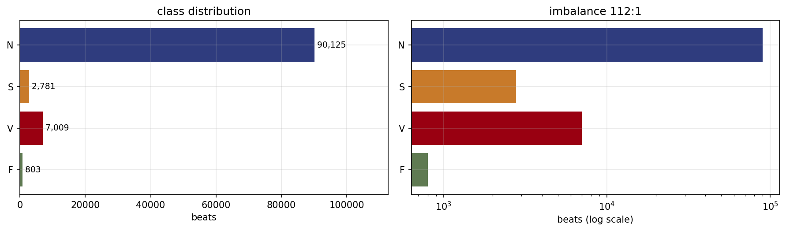

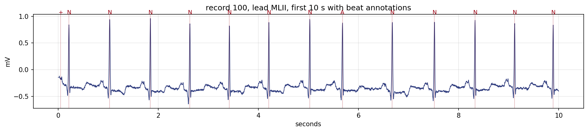

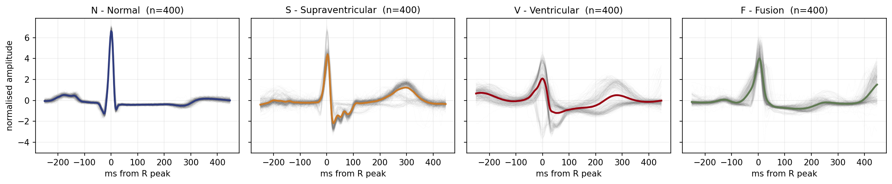

## 3. Preprocessing

**`04_preprocessing_steps.csv`**

| step | method | removes |
|---|---|---|
| Baseline removal | median filter 200 ms then 600 ms | respiration drift |
| Bandpass | Butterworth order 3, 0.5-40 Hz, zero phase | power-line hum, muscle noise |
| Segmentation | 90 samples before R, 162 after (252 total, 700 ms) | inter-beat gaps |
| Normalisation | per beat, zero mean unit variance | amplitude differences between recordings |

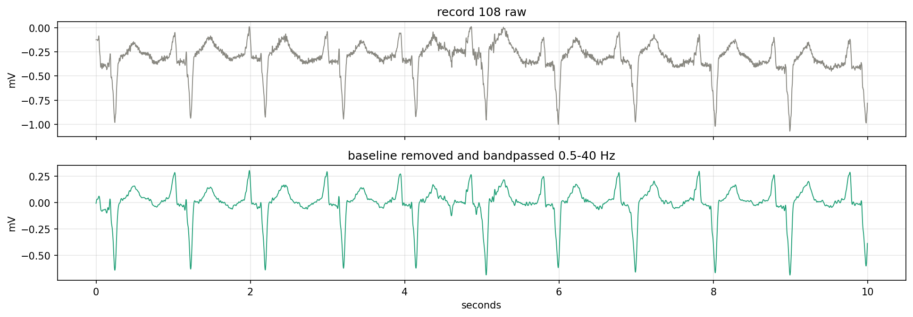

## 4. Features

**`05_feature_catalogue.csv`**

| family | n | features | purpose |
|---|---|---|---|
| Timing (RR) | 8 | pre_rr, post_rr, local_rr, global_rr + 4 ratios | is this beat early or late relative to the patient's own rhythm |
| Beat shape | 32 | morph0 .. morph31 | the 700 ms curve resampled to 32 points |
| Wavelet | 15 | w0..w4 energy, std, mean (db4, level 4) | energy at five frequency scales; wide beats shift energy to coarse bands |
| Statistics | 6 | skew, kurt, energy, rpeak_amp, min_amp, qrs_width | sharpness, asymmetry and a direct width measurement |
| TOTAL | 61 |  |  |

**`08_feature_selection.csv`**

| family | kept |
|---|---|
| rr | 8 |
| morph | 32 |
| wavelet | 13 |
| stats | 6 |
| TOTAL kept | 59 |
| dropped (corr > 0.97) | 2 |

**`09_univariate_separation.csv`**

| feature | f_statistic | family |
|---|---|---|
| rpeak_amp | 11257.25 | stats |
| post_over_pre | 11210.38 | rr |
| pre_over_local | 10060.98 | rr |
| morph11 | 7303.28 | morph |
| w2_std | 6251.06 | wavelet |
| skew | 5740.21 | stats |
| kurt | 5357.44 | stats |
| w3_std | 4440.11 | wavelet |
| w1_std | 4014.33 | wavelet |
| morph9 | 3642.69 | morph |
| w2_energy | 3388.75 | wavelet |
| morph8 | 3228.52 | morph |
| w0_energy | 3167.3 | wavelet |
| w1_mean | 2215.48 | wavelet |
| w3_energy | 2191.28 | wavelet |

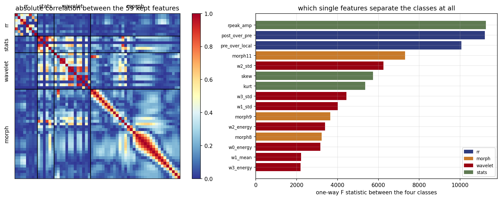

## 5. Data validation

**`06_data_validation.csv`**

| check | value | status |
|---|---|---|
| Beats extracted | 100,679 | ok |
| Records | 44 | ok |
| Features designed | 61 | ok |
| Missing or infinite values | 0 | ok |
| Constant features | 0 | ok |
| Classes present | F, N, S, V | ok |
| Patients in both DS1 and DS2 | 0 | ok |

**`07_minority_concentration.csv`**

| class | split | beats | records | top_record | top_beats | top_share_pct | top3_share_pct |
|---|---|---|---|---|---|---|---|
| S | DS1 | 944 | 16 | 209 | 383 | 40.6 | 65.5 |
| S | DS2 | 1837 | 16 | 232 | 1382 | 75.2 | 89.6 |
| F | DS1 | 414 | 10 | 208 | 372 | 89.9 | 95.9 |
| F | DS2 | 388 | 7 | 213 | 362 | 93.3 | 98.7 |

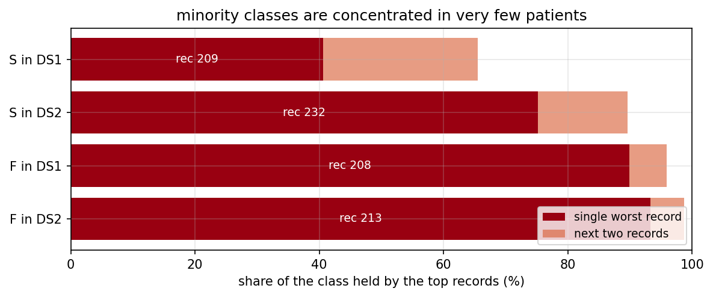

## 6. Validation protocols

**`10_validation_protocols.csv`**

| protocol | train_beats | test_beats | train_patients | test_patients | patients_in_both |
|---|---|---|---|---|---|
| random | 75509 | 25170 | 44 | 44 | 44 |
| inter-patient | 50994 | 49685 | 22 | 22 | 0 |

## 7. Models and hyperparameter search

**`11_models.csv`**

| model | name | boundary | role |
|---|---|---|---|
| logreg | Logistic regression | one straight boundary | baseline every other model must beat |
| linsvm | Linear SVM | straight, widest margin | tests whether better placement helps |
| rbfsvm | RBF SVM | curved | tests whether curvature helps |
| rf | Random forest | staircase of thresholds | ensemble, and reports feature importance |

**`12_hyperparameter_search.csv`**

| split | model | params | cv_train_f1 | cv_test_f1 | cv_std | rank |
|---|---|---|---|---|---|---|
| inter-patient | linsvm | C=0.01 | 0.8273 | 0.3784 | 0.0698 | 1 |
| inter-patient | linsvm | C=0.1 | 0.8413 | 0.3653 | 0.0705 | 2 |
| inter-patient | linsvm | C=1.0 | 0.8451 | 0.3588 | 0.068 | 3 |
| inter-patient | logreg | C=0.1 | 0.7404 | 0.3598 | 0.0837 | 1 |
| inter-patient | logreg | C=1.0 | 0.7591 | 0.3488 | 0.0786 | 2 |
| inter-patient | logreg | C=10.0 | 0.7737 | 0.3439 | 0.0799 | 3 |
| inter-patient | logreg | C=0.01 | 0.7224 | 0.3415 | 0.0399 | 4 |
| inter-patient | rbfsvm | C=1, gamma=scale | 0.9542 | 0.4414 | 0.1237 | 1 |
| inter-patient | rbfsvm | C=10, gamma=scale | 0.979 | 0.4253 | 0.1094 | 2 |
| inter-patient | rf | max_depth=6, min_samples_leaf=5 | 0.9134 | 0.4469 | 0.0983 | 1 |
| inter-patient | rf | max_depth=6, min_samples_leaf=1 | 0.9108 | 0.4352 | 0.0888 | 2 |
| inter-patient | rf | max_depth=8, min_samples_leaf=5 | 0.9661 | 0.4156 | 0.0767 | 3 |
| inter-patient | rf | max_depth=12, min_samples_leaf=5 | 0.9894 | 0.4148 | 0.0769 | 4 |
| inter-patient | rf | max_depth=8, min_samples_leaf=1 | 0.9708 | 0.4134 | 0.0706 | 5 |
| inter-patient | rf | max_depth=None, min_samples_leaf=5 | 0.9918 | 0.4111 | 0.0755 | 6 |
| inter-patient | rf | max_depth=12, min_samples_leaf=1 | 0.9957 | 0.4081 | 0.0678 | 7 |
| inter-patient | rf | max_depth=None, min_samples_leaf=1 | 1.0 | 0.3868 | 0.0811 | 8 |
| random | linsvm | C=1.0 | 0.8205 | 0.5085 | 0.072 | 1 |
| random | linsvm | C=0.1 | 0.8183 | 0.5064 | 0.0781 | 2 |
| random | linsvm | C=0.01 | 0.8013 | 0.4927 | 0.0898 | 3 |
| random | logreg | C=0.01 | 0.6764 | 0.4871 | 0.0697 | 1 |
| random | logreg | C=10.0 | 0.7 | 0.4862 | 0.0639 | 2 |
| random | logreg | C=1.0 | 0.6975 | 0.4855 | 0.068 | 3 |
| random | logreg | C=0.1 | 0.6896 | 0.482 | 0.0751 | 4 |
| random | rbfsvm | C=1, gamma=scale | 0.8902 | 0.4885 | 0.1159 | 1 |
| random | rbfsvm | C=10, gamma=scale | 0.971 | 0.4834 | 0.1205 | 2 |
| random | rf | max_depth=6, min_samples_leaf=1 | 0.8526 | 0.5231 | 0.0735 | 1 |
| random | rf | max_depth=8, min_samples_leaf=5 | 0.9207 | 0.517 | 0.0737 | 2 |
| random | rf | max_depth=6, min_samples_leaf=5 | 0.8488 | 0.5169 | 0.0721 | 3 |
| random | rf | max_depth=8, min_samples_leaf=1 | 0.9246 | 0.5166 | 0.0739 | 4 |
| random | rf | max_depth=12, min_samples_leaf=5 | 0.9625 | 0.508 | 0.0709 | 5 |
| random | rf | max_depth=None, min_samples_leaf=5 | 0.9813 | 0.5017 | 0.0742 | 6 |
| random | rf | max_depth=12, min_samples_leaf=1 | 0.9699 | 0.4875 | 0.0636 | 7 |
| random | rf | max_depth=None, min_samples_leaf=1 | 1.0 | 0.4694 | 0.0493 | 8 |

## 8. Model evaluation

**`13_model_metrics.csv`**

| split | model | accuracy | bal_acc | f1_macro | f1_weighted | kappa | train_f1 | train_secs | log_loss | brier | f1_N | f1_S | f1_V | f1_F | overfit_gap |
|---|---|---|---|---|---|---|---|---|---|---|---|---|---|---|---|
| random | logreg | 0.8863 | 0.8981 | 0.6371 | 0.9122 | 0.5947 | 0.6442 | 18.3 | 0.351 | 0.1788 | 0.936 | 0.605 | 0.806 | 0.201 | 0.0071 |
| random | linsvm | 0.9667 | 0.8645 | 0.7929 | 0.9689 | 0.8377 | 0.7884 | 15.3 |  |  | 0.984 | 0.738 | 0.913 | 0.537 | -0.0045 |
| random | rf | 0.9548 | 0.935 | 0.7735 | 0.9605 | 0.7999 | 0.7835 | 853.0 | 0.2486 | 0.0989 | 0.976 | 0.7 | 0.923 | 0.496 | 0.01 |
| random | rbfsvm | 0.9786 | 0.945 | 0.8491 | 0.9807 | 0.896 | 0.8774 | 98.8 |  |  | 0.989 | 0.865 | 0.967 | 0.576 | 0.0283 |
| inter-patient | logreg | 0.7668 | 0.5762 | 0.4624 | 0.8271 | 0.3209 | 0.6913 | 15.1 | 0.7418 | 0.3623 | 0.865 | 0.122 | 0.806 | 0.057 | 0.2289 |
| inter-patient | linsvm | 0.8987 | 0.5478 | 0.4929 | 0.908 | 0.5661 | 0.8172 | 15.4 |  |  | 0.957 | 0.161 | 0.765 | 0.089 | 0.3243 |
| inter-patient | rf | 0.8837 | 0.5964 | 0.5298 | 0.898 | 0.5197 | 0.8824 | 834.6 | 0.4397 | 0.2094 | 0.935 | 0.185 | 0.887 | 0.112 | 0.3526 |
| inter-patient | rbfsvm | 0.8441 | 0.512 | 0.4795 | 0.8756 | 0.43 | 0.9487 | 80.0 |  |  | 0.916 | 0.137 | 0.845 | 0.02 | 0.4692 |

**`14_per_class_metrics.csv`**

| split | best_model | class | meaning | precision | recall | f1 | support |
|---|---|---|---|---|---|---|---|
| random | rbfsvm | N | Normal | 0.997 | 0.981 | 0.989 | 22522 |
| random | rbfsvm | S | Supraventricular | 0.814 | 0.922 | 0.865 | 695 |
| random | rbfsvm | V | Ventricular | 0.958 | 0.976 | 0.967 | 1752 |
| random | rbfsvm | F | Fusion | 0.423 | 0.9 | 0.576 | 201 |
| inter-patient | rf | N | Normal | 0.961 | 0.911 | 0.935 | 44240 |
| inter-patient | rf | S | Supraventricular | 0.166 | 0.207 | 0.185 | 1837 |
| inter-patient | rf | V | Ventricular | 0.816 | 0.971 | 0.887 | 3220 |
| inter-patient | rf | F | Fusion | 0.069 | 0.296 | 0.112 | 388 |

**`15_confusion_matrix.csv`**

| split | true | predicted | beats |
|---|---|---|---|
| random | N | N | 22099 |
| random | N | S | 140 |
| random | N | V | 54 |
| random | N | F | 229 |
| random | S | N | 41 |
| random | S | S | 641 |
| random | S | V | 13 |
| random | S | F | 0 |
| random | V | N | 19 |
| random | V | S | 5 |
| random | V | V | 1710 |
| random | V | F | 18 |
| random | F | N | 11 |
| random | F | S | 1 |
| random | F | V | 8 |
| random | F | F | 181 |
| inter-patient | N | N | 40283 |
| inter-patient | N | S | 1875 |
| inter-patient | N | V | 552 |
| inter-patient | N | F | 1530 |
| inter-patient | S | N | 1399 |
| inter-patient | S | S | 381 |
| inter-patient | S | V | 56 |
| inter-patient | S | F | 1 |
| inter-patient | V | N | 42 |
| inter-patient | V | S | 34 |
| inter-patient | V | V | 3128 |
| inter-patient | V | F | 16 |
| inter-patient | F | N | 176 |
| inter-patient | F | S | 1 |
| inter-patient | F | V | 96 |
| inter-patient | F | F | 115 |

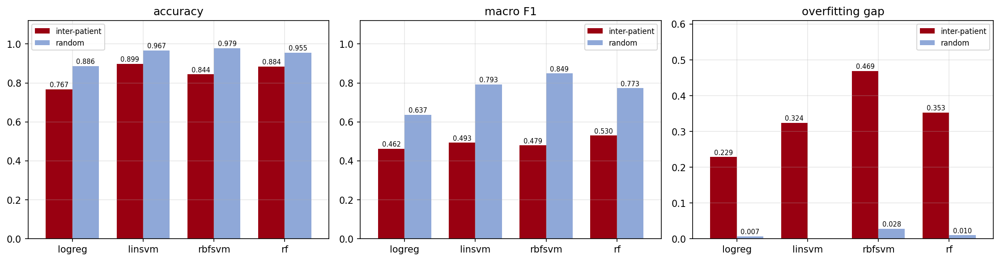

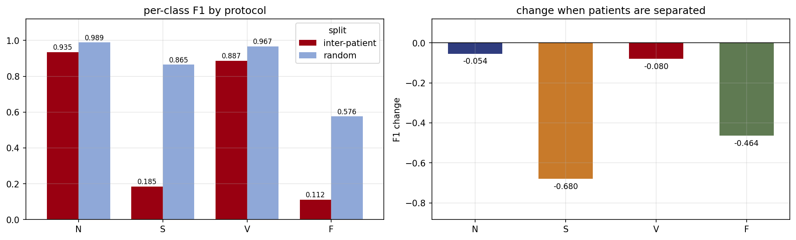

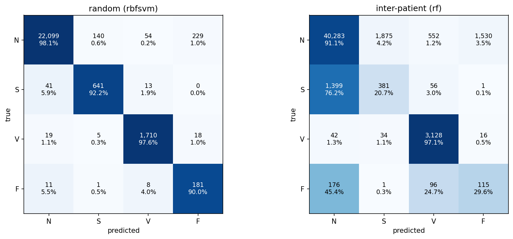

## 9. Feature importance

**`16_top_features.csv`**

| rank | feature | family | importance |
|---|---|---|---|
| 1 | pre_over_global | rr | 0.08353 |
| 2 | pre_rr | rr | 0.07299 |
| 3 | global_rr | rr | 0.06699 |
| 4 | pre_over_local | rr | 0.0607 |
| 5 | post_over_pre | rr | 0.04548 |
| 6 | morph31 | morph | 0.04499 |
| 7 | kurt | stats | 0.03587 |
| 8 | w3_std | wavelet | 0.03465 |
| 9 | min_amp | stats | 0.03017 |
| 10 | morph30 | morph | 0.02901 |
| 11 | rpeak_amp | stats | 0.02869 |
| 12 | w2_energy | wavelet | 0.028 |
| 13 | post_rr | rr | 0.02799 |
| 14 | w2_std | wavelet | 0.02593 |
| 15 | w4_energy | wavelet | 0.02566 |
| 16 | w3_energy | wavelet | 0.02539 |
| 17 | local_rr | rr | 0.02281 |
| 18 | local_over_global | rr | 0.02088 |
| 19 | w0_energy | wavelet | 0.01706 |
| 20 | morph11 | morph | 0.01573 |

**`17_family_importance.csv`**

| family | total_importance | n_features | mean_importance | importance_per_feature_rank |
|---|---|---|---|---|
| rr | 0.40137 | 8 | 0.05017 | 1 |
| morph | 0.30416 | 32 | 0.0095 | 4 |
| wavelet | 0.18352 | 13 | 0.01412 | 3 |
| stats | 0.11095 | 6 | 0.01849 | 2 |

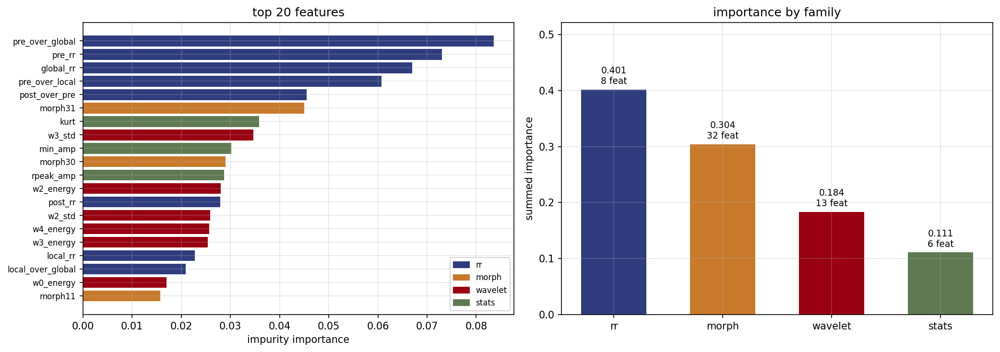

## 10. Feature family ablation

**`18_family_ablation.csv`**

| family | n_features | f1_macro | accuracy | f1_N | f1_S | f1_V | f1_F |
|---|---|---|---|---|---|---|---|
| rr | 8 | 0.4369 | 0.9004 | 0.9545 | 0.0906 | 0.6981 | 0.0044 |
| morph | 32 | 0.4126 | 0.92 | 0.9604 | 0.0033 | 0.6869 | 0.0 |
| wavelet | 13 | 0.367 | 0.9075 | 0.951 | 0.0084 | 0.5044 | 0.0042 |
| stats | 6 | 0.3826 | 0.9097 | 0.9531 | 0.001 | 0.5761 | 0.0 |
| ALL | 59 | 0.4908 | 0.9463 | 0.971 | 0.0702 | 0.9221 | 0.0 |

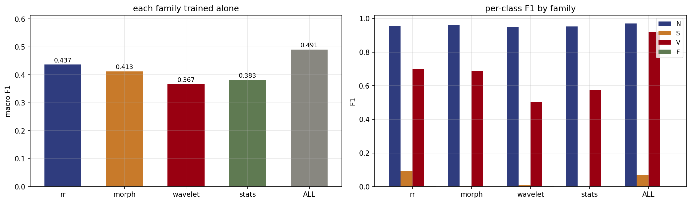

## 11. Feature combinations

**`19_feature_combinations.csv`**

| combination | n_features | f1_macro | accuracy | f1_N | f1_S | f1_V | f1_F |
|---|---|---|---|---|---|---|---|
| rr+wavelet+stats | 27 | 0.5209 | 0.9341 | 0.9655 | 0.1794 | 0.9321 | 0.0066 |
| rr+wavelet | 21 | 0.5207 | 0.9156 | 0.9552 | 0.1982 | 0.922 | 0.0076 |
| rr+stats | 14 | 0.5105 | 0.9357 | 0.9658 | 0.1559 | 0.9203 | 0.0 |
| ALL | 59 | 0.4908 | 0.9463 | 0.971 | 0.0702 | 0.9221 | 0.0 |
| rr+morph | 40 | 0.4668 | 0.938 | 0.97 | 0.0772 | 0.8201 | 0.0 |
| rr | 8 | 0.4369 | 0.9004 | 0.9545 | 0.0906 | 0.6981 | 0.0044 |
| morph+wavelet | 45 | 0.4252 | 0.9204 | 0.9566 | 0.0022 | 0.7419 | 0.0 |
| morph | 32 | 0.4126 | 0.92 | 0.9604 | 0.0033 | 0.6869 | 0.0 |

**`20_combination_verdict.csv`**

| question | answer | f1_macro | f1_S |
|---|---|---|---|
| Best combination | rr+wavelet+stats | 0.5209 | 0.1794 |
| Using every feature | ALL | 0.4908 | 0.0702 |
| Cost of adding the rest | -0.0301 macro F1 |  | -0.1092 |

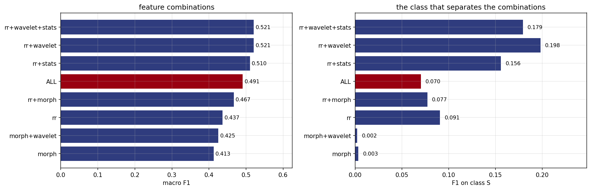

## 12. Class imbalance experiment

**`21_imbalance_experiment.csv`**

| strategy | train_rows | N_to_F_ratio | f1_macro | accuracy | f1_N | f1_S | f1_V | f1_F |
|---|---|---|---|---|---|---|---|---|
| none (class_weight off) | 25000 | 110:1 | 0.4915 | 0.9254 | 0.9592 | 0.1715 | 0.8352 | 0.0 |
| class_weight balanced | 25000 | 110:1 | 0.4908 | 0.9463 | 0.971 | 0.0702 | 0.9221 | 0.0 |
| random oversample | 89908 | 1:1 | 0.5019 | 0.9452 | 0.9707 | 0.1087 | 0.9284 | 0.0 |
| SMOTE | 89908 | 1:1 | 0.5134 | 0.914 | 0.953 | 0.1773 | 0.922 | 0.0013 |
| random undersample | 812 | 1:1 | 0.5204 | 0.819 | 0.8932 | 0.1687 | 0.885 | 0.1344 |

**`22_imbalance_verdict.csv`**

| finding | value |
|---|---|
| Spread in F1(S) across all five strategies | 0.1071 |
| Spread in macro F1 across all five strategies | 0.0296 |
| Best F1(S) achieved by any balancing | 0.1773 (SMOTE) |
| F1(S) from feature choice instead (section 13) | 0.1982 (rr+wavelet) |
| Conclusion | imbalance matters |

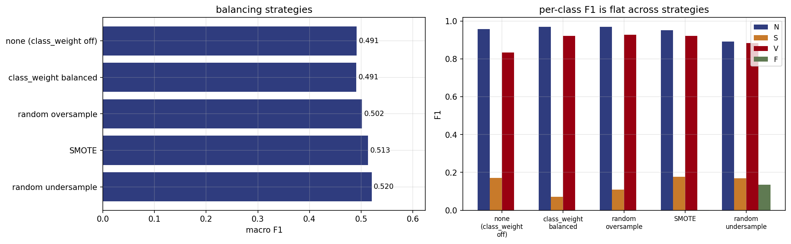

## 13. Learning curve

**`23_learning_curve.csv`**

| fraction | train_beats | train_patients | train_f1 | test_f1 | test_acc | f1_S | f1_V | gap |
|---|---|---|---|---|---|---|---|---|
| 0.05 | 1250 | 22 | 1.0 | 0.4675 | 0.9434 | 0.0022 | 0.8986 | 0.5325 |
| 0.1 | 2500 | 22 | 1.0 | 0.4945 | 0.9458 | 0.0827 | 0.9247 | 0.5055 |
| 0.2 | 5000 | 22 | 1.0 | 0.4938 | 0.9472 | 0.0758 | 0.9279 | 0.5062 |
| 0.4 | 10000 | 22 | 1.0 | 0.4976 | 0.9479 | 0.0845 | 0.9338 | 0.5024 |
| 0.7 | 17500 | 22 | 1.0 | 0.4915 | 0.9448 | 0.0848 | 0.911 | 0.5085 |
| 1.0 | 25000 | 22 | 1.0 | 0.4908 | 0.9463 | 0.0702 | 0.9221 | 0.5092 |

**`24_learning_curve_gain.csv`**

| data_increase | macro_f1_gain | f1_S_gain | patients_gain |
|---|---|---|---|
| 20x | 0.0233 | 0.068 | 0 |

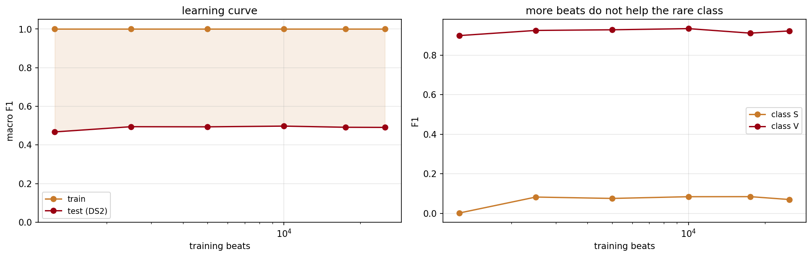

## 14. Validation curves

**`25_depth_curve.csv`**

| max_depth | train_f1 | test_f1 | gap | f1_S | accuracy |
|---|---|---|---|---|---|
| 2 | 0.623 | 0.5165 | 0.1065 | 0.1771 | 0.8024 |
| 4 | 0.7868 | 0.5374 | 0.2494 | 0.177 | 0.8526 |
| 6 | 0.8832 | 0.5419 | 0.3413 | 0.1796 | 0.876 |
| 8 | 0.9512 | 0.524 | 0.4272 | 0.1948 | 0.9117 |
| 12 | 0.9919 | 0.5243 | 0.4676 | 0.1854 | 0.9416 |
| None | 1.0 | 0.4908 | 0.5092 | 0.0702 | 0.9463 |

**`26_tree_count_curve.csv`**

| n_estimators | train_f1 | test_f1 | gap |
|---|---|---|---|
| 10 | 0.9954 | 0.4593 | 0.5361 |
| 50 | 1.0 | 0.4796 | 0.5204 |
| 100 | 1.0 | 0.489 | 0.511 |
| 200 | 1.0 | 0.4908 | 0.5092 |
| 400 | 1.0 | 0.4919 | 0.5081 |

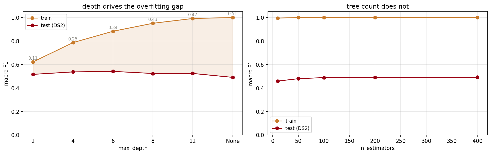

## 15. Cross-validation

**`27_cross_validation.csv`**

| fold | train_patients | test_patients | test_beats | f1_macro | accuracy | f1_N | f1_S | f1_V | f1_F |
|---|---|---|---|---|---|---|---|---|---|
| 1 | 35.0 | 9.0 | 20974.0 | 0.4494 | 0.8863 | 0.9354 | 0.0212 | 0.829 | 0.0119 |
| 2 | 35.0 | 9.0 | 19408.0 | 0.4308 | 0.9488 | 0.9757 | 0.0219 | 0.7256 | 0.0 |
| 3 | 34.0 | 10.0 | 22386.0 | 0.4811 | 0.95 | 0.9747 | 0.0865 | 0.8631 | 0.0 |
| 4 | 35.0 | 9.0 | 20101.0 | 0.593 | 0.9902 | 0.995 | 0.4341 | 0.9429 | 0.0 |
| 5 | 37.0 | 7.0 | 17810.0 | 0.4868 | 0.9554 | 0.9753 | 0.0571 | 0.9149 | 0.0 |
| mean | 35.2 | 8.8 | 20135.8 | 0.4882 | 0.9461 | 0.9712 | 0.1242 | 0.8551 | 0.0024 |
| std | 1.0954 | 1.0954 | 1710.7183 | 0.0629 | 0.0375 | 0.0218 | 0.1754 | 0.0849 | 0.0053 |

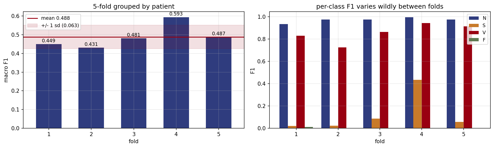

## 16. Per-record error analysis

**`28_per_record.csv`**

| record | beats | accuracy | n_N | recall_N | n_S | recall_S | n_V | recall_V | n_F | recall_F |
|---|---|---|---|---|---|---|---|---|---|---|
| 232 | 1780 | 0.2292 | 398 | 0.9975 | 1382 | 0.008 | 0 |  | 0 |  |
| 233 | 3077 | 0.4514 | 2229 | 0.2544 | 7 | 0.0 | 830 | 0.9855 | 11 | 0.3636 |
| 222 | 2481 | 0.7283 | 2272 | 0.7064 | 209 | 0.9665 | 0 |  | 0 |  |
| 202 | 2135 | 0.7719 | 2060 | 0.7694 | 55 | 0.8 | 19 | 1.0 | 1 | 0.0 |
| 219 | 2154 | 0.8305 | 2082 | 0.8295 | 7 | 0.2857 | 64 | 0.9375 | 1 | 0.0 |
| 210 | 2648 | 0.8637 | 2421 | 0.8674 | 22 | 0.5909 | 195 | 0.8923 | 10 | 0.0 |
| 213 | 3250 | 0.9086 | 2640 | 0.9962 | 28 | 0.1429 | 220 | 0.9455 | 362 | 0.3066 |
| 221 | 2427 | 0.9114 | 2031 | 0.8946 | 0 |  | 396 | 0.9975 | 0 |  |
| 105 | 2567 | 0.9525 | 2526 | 0.9521 | 0 |  | 41 | 0.9756 | 0 |  |
| 200 | 2600 | 0.9685 | 1742 | 0.9765 | 30 | 0.9 | 826 | 0.9564 | 2 | 0.0 |
| 113 | 1794 | 0.9838 | 1788 | 0.9838 | 6 | 1.0 | 0 |  | 0 |  |
| 123 | 1517 | 0.9848 | 1514 | 0.9848 | 0 |  | 3 | 1.0 | 0 |  |
| 214 | 2258 | 0.9925 | 2001 | 0.993 | 0 |  | 256 | 0.9922 | 1 | 0.0 |
| 234 | 2753 | 0.9935 | 2700 | 0.9996 | 50 | 0.66 | 3 | 1.0 | 0 |  |
| 228 | 2053 | 0.9942 | 1688 | 0.9947 | 3 | 1.0 | 362 | 0.9917 | 0 |  |
| 231 | 1570 | 0.9975 | 1567 | 0.9981 | 1 | 0.0 | 2 | 1.0 | 0 |  |
| 212 | 2747 | 0.9978 | 2747 | 0.9978 | 0 |  | 0 |  | 0 |  |
| 121 | 1862 | 0.9989 | 1860 | 0.9989 | 1 | 1.0 | 1 | 1.0 | 0 |  |
| 111 | 2124 | 0.9991 | 2123 | 0.9991 | 0 |  | 1 | 1.0 | 0 |  |
| 103 | 2083 | 0.9995 | 2081 | 1.0 | 2 | 0.5 | 0 |  | 0 |  |
| 100 | 2271 | 0.9996 | 2237 | 0.9996 | 33 | 1.0 | 1 | 1.0 | 0 |  |
| 117 | 1534 | 1.0 | 1533 | 1.0 | 1 | 1.0 | 0 |  | 0 |  |

**`29_who_holds_class_S.csv`**

| record | S_beats | share_of_DS2_S_pct | recall_S |
|---|---|---|---|
| 232 | 1382 | 75.2 | 0.008 |
| 222 | 209 | 11.4 | 0.9665 |
| 202 | 55 | 3.0 | 0.8 |
| 234 | 50 | 2.7 | 0.66 |
| 100 | 33 | 1.8 | 1.0 |
| 200 | 30 | 1.6 | 0.9 |
| 213 | 28 | 1.5 | 0.1429 |
| 210 | 22 | 1.2 | 0.5909 |
| 233 | 7 | 0.4 | 0.0 |
| 219 | 7 | 0.4 | 0.2857 |
| 113 | 6 | 0.3 | 1.0 |
| 228 | 3 | 0.2 | 1.0 |
| 103 | 2 | 0.1 | 0.5 |
| 117 | 1 | 0.1 | 1.0 |
| 121 | 1 | 0.1 | 1.0 |
| 231 | 1 | 0.1 | 0.0 |

**`30_single_patient_effect.csv`**

| test_set | patients | beats | f1_macro | f1_S | f1_V |
|---|---|---|---|---|---|
| DS2 complete | 22 | 49685 | 0.4908 | 0.0702 | 0.9221 |
| DS2 without record 232 | 21 | 47905 | 0.5374 | 0.2414 | 0.9224 |
| change | -1 | -1780 | 0.0466 | 0.1712 | 0.0003 |

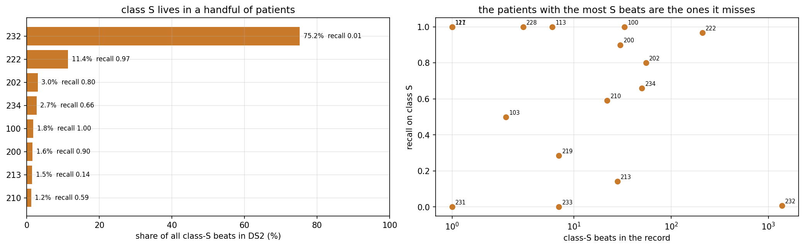

## 17. Honest model selection

**`31_honest_selection.csv`**

| max_depth | DS1_inner_cv_f1 | DS1_inner_cv_sd | DS2_f1 |
|---|---|---|---|
| 2 | 0.4459 | 0.1321 | 0.5165 |
| 4 | 0.4633 | 0.1192 | 0.5374 |
| 6 | 0.4295 | 0.087 | 0.5419 |
| 8 | 0.4131 | 0.0704 | 0.524 |
| 12 | 0.4089 | 0.0668 | 0.5243 |
| None | 0.3868 | 0.0812 | 0.4908 |

**`32_selection_bias.csv`**

| procedure | max_depth | reported_f1 |
|---|---|---|
| Chosen on DS1 inner CV, reported on DS2 | 4 | 0.5374 |
| Chosen by reading DS2 (what not to do) | 6 | 0.5419 |
| Optimism from letting the test set choose |  | 0.0045 |

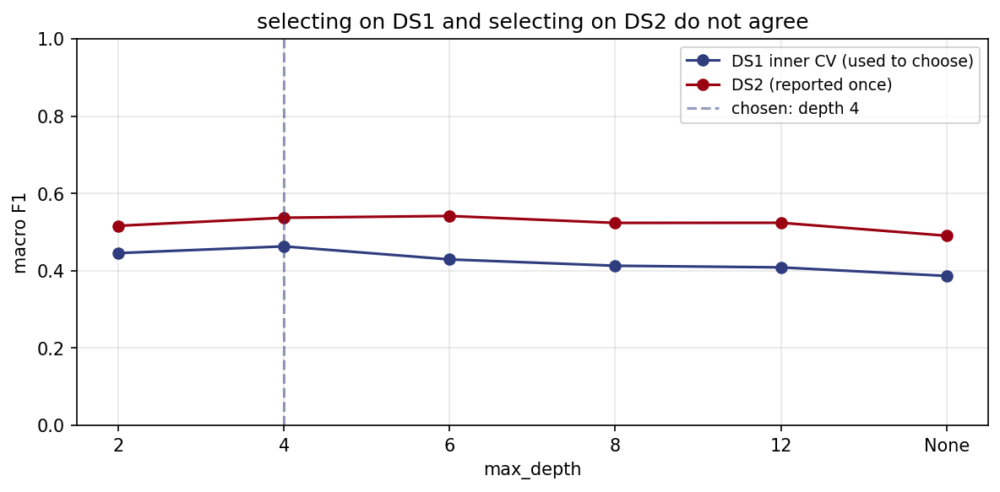

## 18. Three-class variant

**`33_three_class.csv`**

| class | meaning | precision | recall | f1 | support |
|---|---|---|---|---|---|
| N | Normal | 0.955 | 0.995 | 0.975 | 44240 |
| S | Supraventricular | 0.67 | 0.032 | 0.061 | 1837 |
| V | Ventricular | 0.935 | 0.9 | 0.917 | 3220 |
| MACRO |  | 0.853 | 0.643 | 0.651 | 49297 |

**`34_three_vs_four.csv`**

| task | classes | macro_f1 |
|---|---|---|
| 4 classes (N/S/V/F) | 4 | 0.5298 |
| 3 classes (N/S/V) | 3 | 0.6511 |
| difference | -1 | 0.1213 |

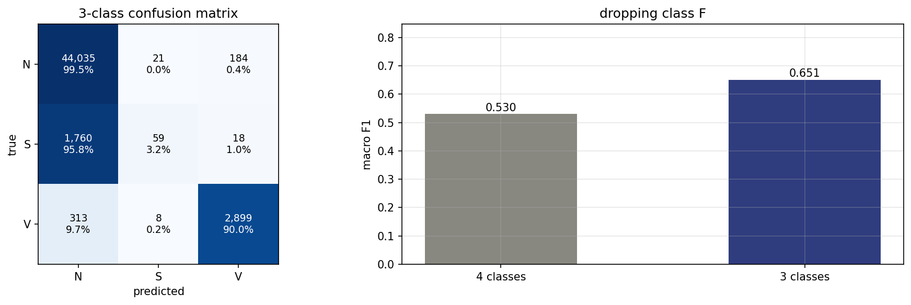

## 19. Pipeline validation

**`35_pipeline_validation.csv`**

| baseline | f1_macro | accuracy | beats_always_N_by |
|---|---|---|---|
| Always predict N | 0.2355 | 0.8904 | 0.0 |
| Uniform random | 0.1435 | 0.2499 | -0.092 |
| Random from class prior | 0.2496 | 0.8055 | 0.0141 |
| Labels shuffled in training | 0.2355 | 0.8904 | 0.0 |
| Real model | 0.4908 | 0.9463 | 0.2553 |

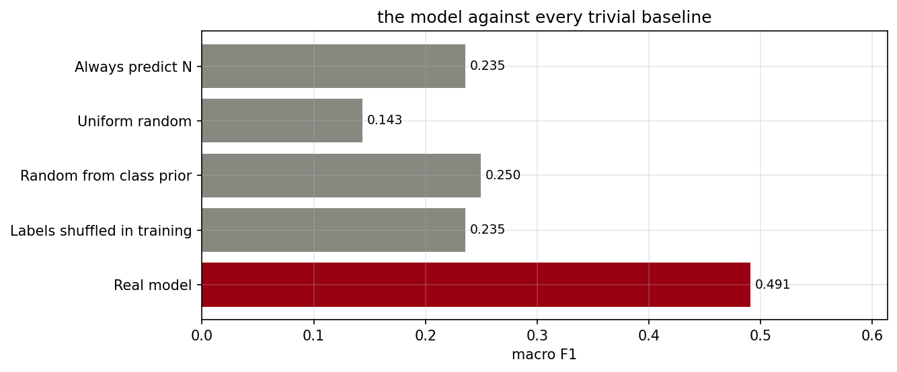

## 20. Summary

**`36_summary_of_findings.csv`**

| n | finding | evidence | table | figure |
|---|---|---|---|---|
| 1 | Best model under the honest protocol | rf: accuracy 0.8837, macro F1 0.5298, kappa 0.5197 | 13_model_metrics | 07_model_comparison |
| 2 | Accuracy hides the failure; macro F1 does not | accuracy falls +7.1 pts between protocols, macro F1 falls +24.4 pts | 13_model_metrics | 07_model_comparison |
| 3 | Weighted F1 is accuracy wearing a different name | weighted F1 0.8980 vs accuracy 0.8837, difference 0.0143 | 13_model_metrics | 07_model_comparison |
| 4 | Sharing patients between train and test inflates the rare classes | F1(S) 0.865 -> 0.185, F1(F) 0.576 -> 0.112 | 14_per_class_metrics | 08_per_class_f1 |
| 5 | Class imbalance is not the bottleneck | five balancing strategies move F1(S) by only 0.1071 | 21_imbalance_experiment | 13_imbalance_experiment |
| 6 | Only the timing features detect class S | RR alone F1(S) 0.0906, best of the other three families 0.0084 | 18_family_ablation | 11_family_ablation |
| 7 | Adding every feature is worse than choosing a subset | rr+wavelet+stats macro F1 0.5209 vs ALL 0.4908 | 19_feature_combinations | 12_feature_combinations |
| 8 | More beats do not help; more patients would | 20x more training beats buys +0.0233 macro F1 | 23_learning_curve | 14_learning_curve |
| 9 | Depth causes the overfitting, not tree count | gap 0.249 at depth 4 vs 0.509 unlimited; 0.508 to 0.536 across 10-400 trees | 25_depth_curve | 15_validation_curves |
| 10 | The result is one patient away from looking different | excluding record 232 changes F1(S) by +0.1712 | 30_single_patient_effect | 17_per_record_analysis |
| 11 | Choosing hyperparameters on the test set adds optimism | +0.0045 macro F1 from letting DS2 pick the depth | 32_selection_bias | 18_honest_selection |
| 12 | Fold-to-fold variation is larger than any tuning gain | grouped 5-fold macro F1 0.4882 +/- 0.0629 | 27_cross_validation | 16_cross_validation |
| 13 | The pipeline has no leakage of its own | shuffled labels score 0.2355 against the always-N baseline 0.2355 | 35_pipeline_validation | 20_pipeline_validation |
| 14 | Dropping class F does not rescue the task | 3-class macro F1 0.6511 vs 4-class 0.5298 | 34_three_vs_four | 19_three_class |

**`37_what_moves_the_result.csv`**

| lever | macro_f1_swing |
|---|---|
| Evaluation protocol (random vs inter-patient) | 0.2437 |
| Feature subset (8 combinations) | 0.1083 |
| Choice of algorithm (4 models) | 0.0674 |
| Tree depth (6 values) | 0.0511 |
| Tree count (10 to 400) | 0.0326 |
| Class balancing (5 strategies) | 0.0296 |

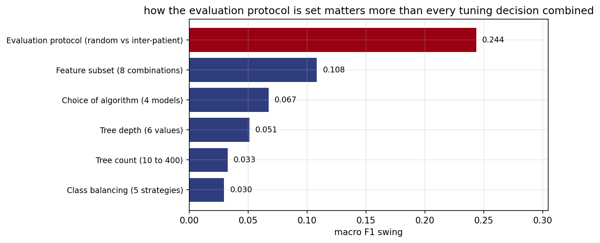

## 21. Files

**`38_file_manifest.csv`**

| folder | file | kind | kb |
|---|---|---|---|
| code | pipeline.py | py | 61.0 |
| notebook | ECG_arrhythmia_classification.ipynb | ipynb | 1783.1 |
| results/figures | 01_class_distribution.png | png | 32.2 |
| results/figures | 02_signal_annotated.png | png | 87.1 |
| results/figures | 03_beat_morphology.png | png | 184.2 |
| results/figures | 04_cleaning.png | png | 163.1 |
| results/figures | 05_minority_concentration.png | png | 47.2 |
| results/figures | 06_feature_correlation.png | png | 105.9 |
| results/figures | 07_model_comparison.png | png | 60.5 |
| results/figures | 08_per_class_f1.png | png | 54.4 |
| results/figures | 09_confusion_matrices.png | png | 82.2 |
| results/figures | 10_feature_importance.png | png | 93.7 |
| results/figures | 11_family_ablation.png | png | 45.7 |
| results/figures | 12_feature_combinations.png | png | 60.4 |
| results/figures | 13_imbalance_experiment.png | png | 73.3 |
| results/figures | 14_learning_curve.png | png | 54.2 |
| results/figures | 15_validation_curves.png | png | 66.2 |
| results/figures | 16_cross_validation.png | png | 51.3 |
| results/figures | 17_per_record_analysis.png | png | 96.8 |
| results/figures | 18_honest_selection.png | png | 52.2 |
| results/figures | 19_three_class.png | png | 58.4 |
| results/figures | 20_pipeline_validation.png | png | 42.5 |
| results/figures | 21_what_moves_the_result.png | png | 62.6 |
| results/tables | 01_data_source.csv | csv | 0.2 |
| results/tables | 02_raw_symbols.csv | csv | 0.1 |
| results/tables | 03_class_distribution.csv | csv | 0.1 |
| results/tables | 04_preprocessing_steps.csv | csv | 0.3 |
| results/tables | 05_feature_catalogue.csv | csv | 0.5 |
| results/tables | 06_data_validation.csv | csv | 0.2 |
| results/tables | 07_minority_concentration.csv | csv | 0.2 |
| results/tables | 08_feature_selection.csv | csv | 0.1 |
| results/tables | 09_univariate_separation.csv | csv | 0.4 |
| results/tables | 10_validation_protocols.csv | csv | 0.1 |
| results/tables | 11_models.csv | csv | 0.3 |
| results/tables | 12_hyperparameter_search.csv | csv | 2.0 |
| results/tables | 13_model_metrics.csv | csv | 0.9 |
| results/tables | 14_per_class_metrics.csv | csv | 0.5 |
| results/tables | 15_confusion_matrix.csv | csv | 0.6 |
| results/tables | 16_top_features.csv | csv | 0.5 |
| results/tables | 17_family_importance.csv | csv | 0.2 |
| results/tables | 18_family_ablation.csv | csv | 0.3 |
| results/tables | 19_feature_combinations.csv | csv | 0.5 |
| results/tables | 20_combination_verdict.csv | csv | 0.2 |
| results/tables | 21_imbalance_experiment.csv | csv | 0.4 |
| results/tables | 22_imbalance_verdict.csv | csv | 0.3 |
| results/tables | 23_learning_curve.csv | csv | 0.4 |
| results/tables | 24_learning_curve_gain.csv | csv | 0.1 |
| results/tables | 25_depth_curve.csv | csv | 0.3 |
| results/tables | 26_tree_count_curve.csv | csv | 0.1 |
| results/tables | 27_cross_validation.csv | csv | 0.5 |
| results/tables | 28_per_record.csv | csv | 1.0 |
| results/tables | 29_who_holds_class_S.csv | csv | 0.3 |
| results/tables | 30_single_patient_effect.csv | csv | 0.2 |
| results/tables | 31_honest_selection.csv | csv | 0.2 |
| results/tables | 32_selection_bias.csv | csv | 0.2 |
| results/tables | 33_three_class.csv | csv | 0.2 |
| results/tables | 34_three_vs_four.csv | csv | 0.1 |
| results/tables | 35_pipeline_validation.csv | csv | 0.2 |
| results/tables | 36_summary_of_findings.csv | csv | 2.0 |
| results/tables | 37_what_moves_the_result.csv | csv | 0.2 |
